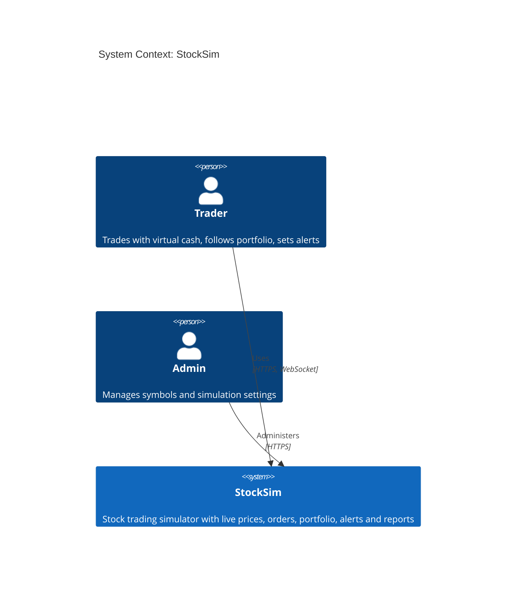
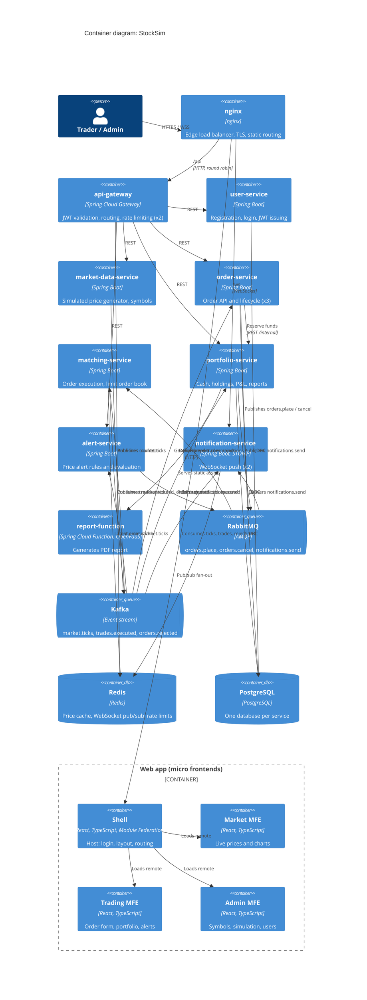
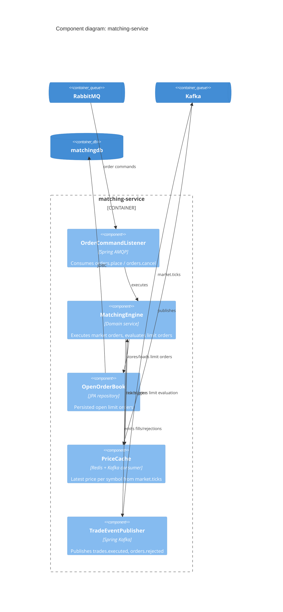
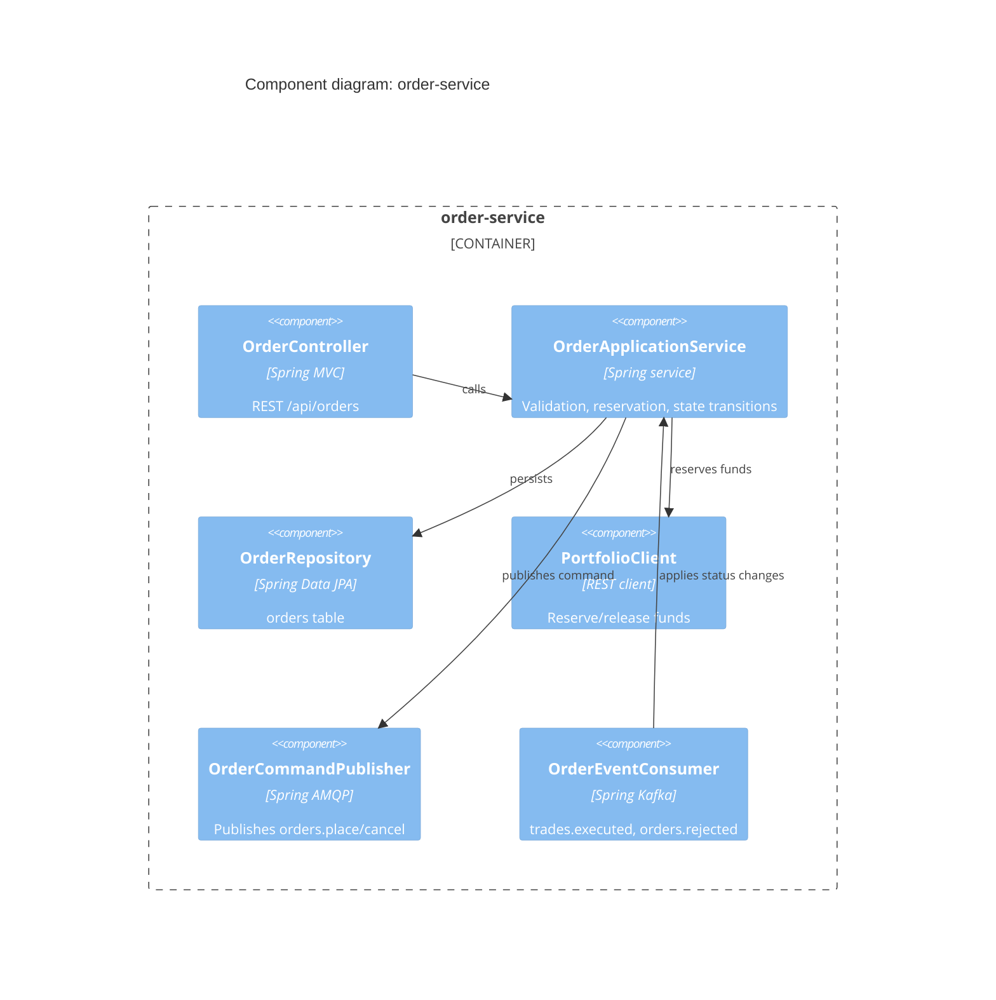

# C4 Model

Rendered by GitHub (Mermaid C4 support is experimental; if a diagram renders poorly, view it in the Mermaid Live Editor).

## Level 1: System Context

## Level 2: Containers

## Level 3: Components of matching-service

## Level 3: Components of order-service

