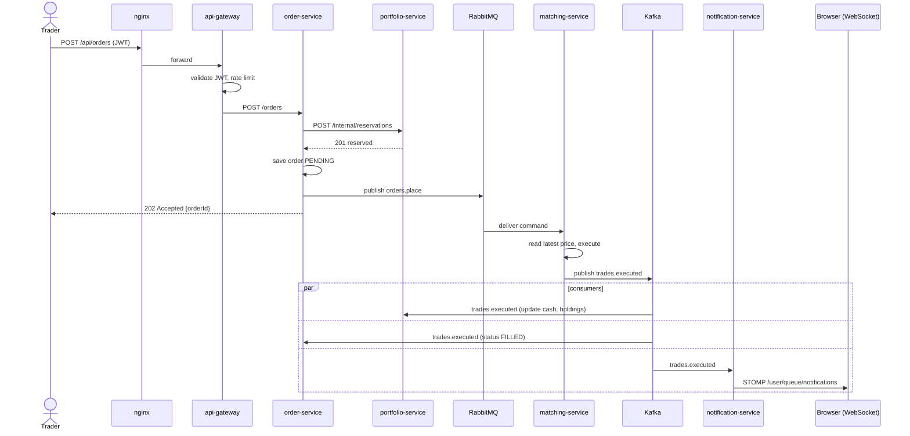
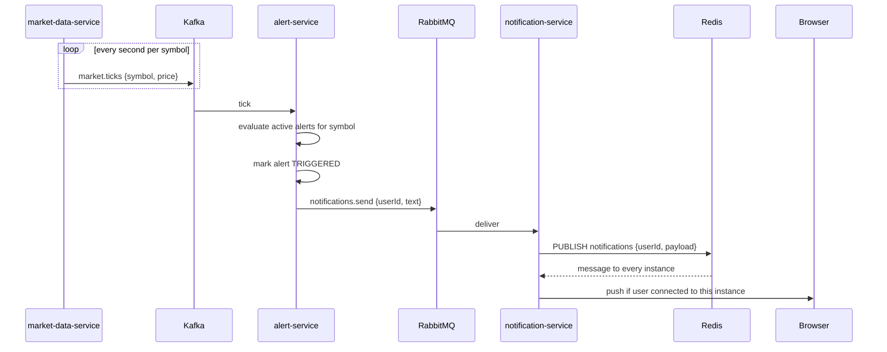
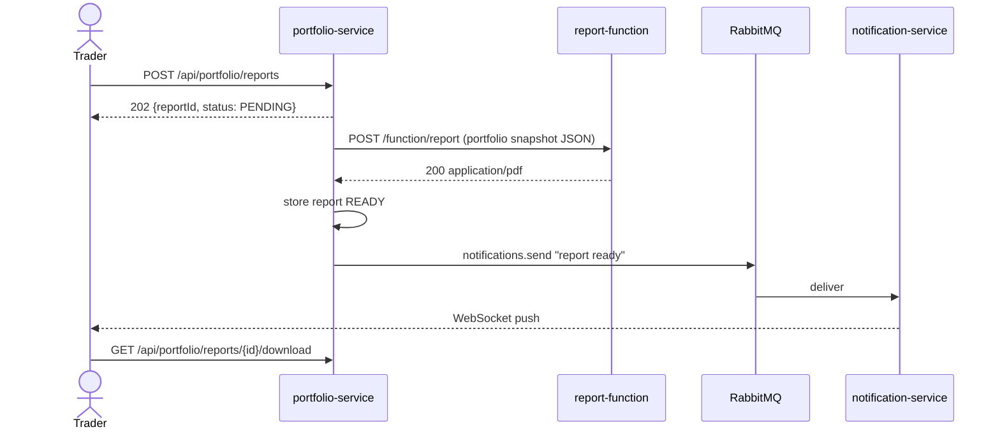
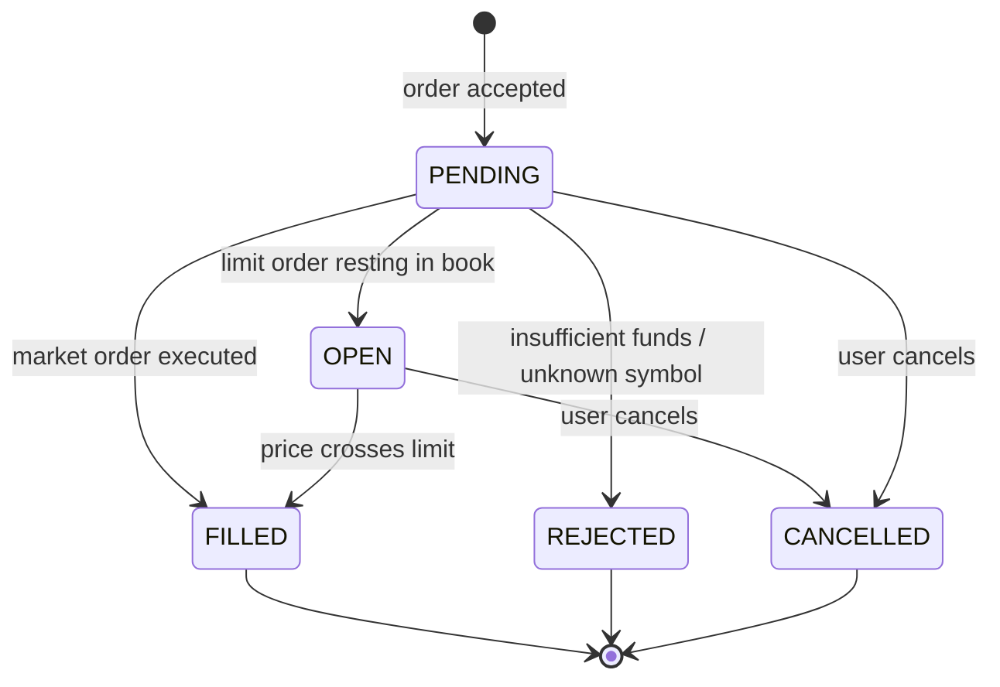
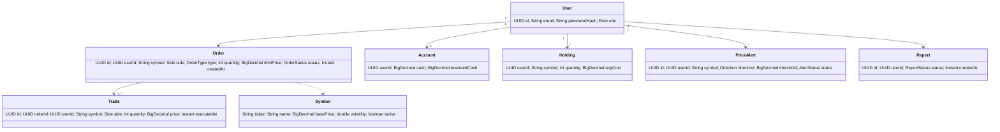
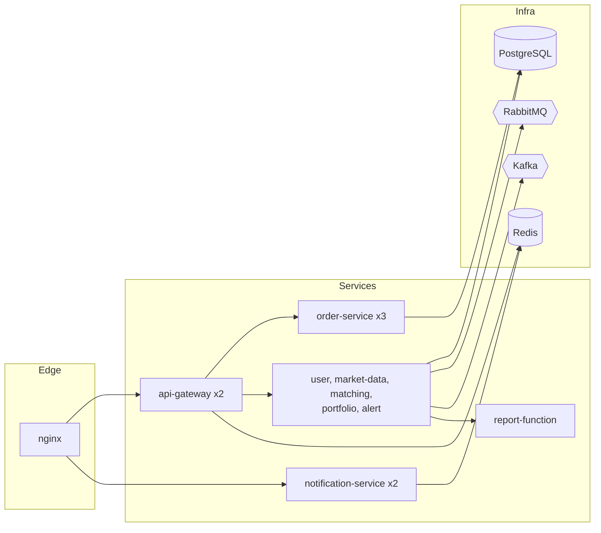

# UML Diagrams

## Sequence: place a market order

## Sequence: price alert

## Sequence: generate report (FaaS)

## State: order lifecycle

## Class diagram: core domain

## Deployment overview

