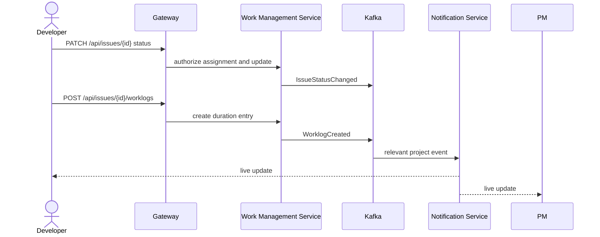
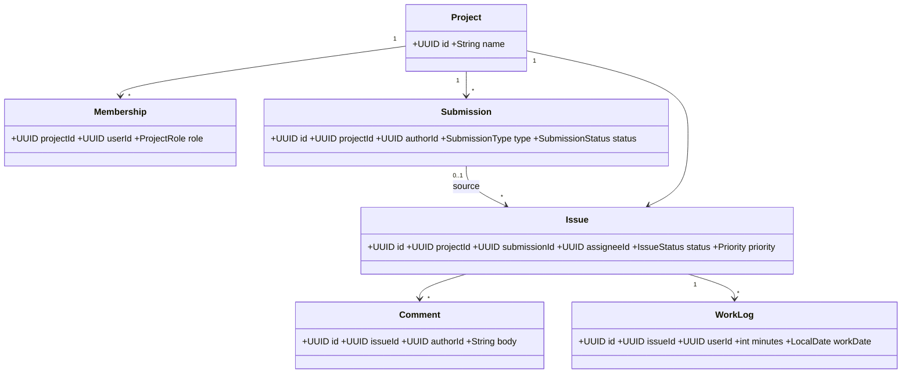

# UML and Workflow Diagrams

## Stakeholder submission to developer issue

```mermaid
sequenceDiagram
  actor S as Stakeholder
  actor PM as Project Manager
  actor D as Developer
  participant G as API Gateway
  participant WM as Work Management Service
  participant K as Kafka
  participant N as Notification Service
  S->>G: POST /api/projects/{id}/submissions (JWT; project Stakeholder)
  G->>WM: validate membership and create submission
  WM-->>S: 201 Created
  WM->>K: submissions.events: SubmissionCreated
  K->>N: event
  N-->>PM: private submission notification
  PM->>G: PATCH /api/submissions/{id} (project Project Manager; triage)
  G->>WM: authorize and update triage
  PM->>G: POST /api/submissions/{id}/issues (project Project Manager)
  G->>WM: validate membership; create and assign linked issue
  WM->>K: issues.events: IssueCreated
  K->>N: event
  N-->>D: private assignment notification
```

## Developer work log



## Issue entity


